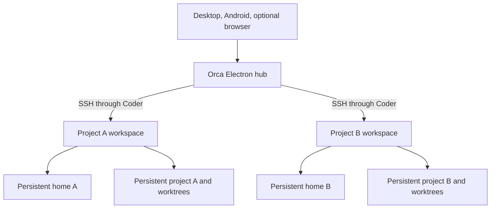

# Orca with persistent Coder project environments

## Status and prerequisites

This is a pilot, not a migration of existing Mux workspaces. The `orca-worker`
template is published through the existing Coder template workflow after merge.
The Orca hub image has its own build workflow. The catalog app is not enabled in
any cluster overlay: promote it only after the acceptance checks below pass.

Required: Coder with the existing Kubernetes provisioner in namespace `coder`,
Linux amd64, private connectivity, Docker for local checks, and a project
repository providing the `coder` account (UID/GID 1000, home `/home/coder`).
The devcontainer needs Bash, curl, tar, sha256sum, getent, cut, and mountpoint.
GitHub external auth is optional and enables private HTTPS cloning.

## Architecture and storage



Each worker has two independent PVCs. Neither depends on `start_count`; only the
Deployment and installer scripts follow the running state. The home is mounted
directly in the agent environment and excluded from Envbuilder's image build.
The setup checks the account and mountpoints before starting the Coder agent.
Project checkout is always `/workspaces/project`.

The design incorporates the Mux fixes already in this repository: commit
`3430eb1` removed the PVC's start/stop count after whole-home data loss; `4a4fde1`
aligned paths with the actual user; the August Docker-cache changes addressed
separate storage corruption. No existing Mux PVC or cache is changed here.

Envbuilder 1.3.0 is in maintenance mode and requires a privileged worker Pod.
This pilot accepts that tradeoff to reuse the existing devcontainer build path
without nested Docker. A Nix environment can later replace project tooling;
it does not replace persistent home storage, and its shell must be activated for
non-interactive agent launches as well as terminals.

## Local hub and worker setup

1. Build the hub from the repository root:

   ```bash
   docker build -t elysium/orca-hub:1.4.248 coder/images/orca-hub
   docker run -d --name orca-hub-pilot \
     --mount type=volume,src=orca-hub-pilot-home,dst=/home/coder \
     -e ORCA_PAIRING_ADDRESS=ws://127.0.0.1:16768 \
     -p 127.0.0.1:16768:6768 elysium/orca-hub:1.4.248
   ```

   Loopback is suitable for an SSH-forwarded browser check, not a phone or remote
   native client. For native clients, bind only an approved private interface and
   advertise its reachable address. Do not expose the runtime port publicly.
   The browser bundle is served at the forwarded port. Pairing is still required.

2. Create an `orca-worker` workspace in Coder. Select the project repository and
   devcontainer directory. Wait for the Codex and OpenCode installers to finish.
   Use one workspace per project. A normal Coder stop retains its two PVCs.

3. Authenticate the hub's Coder CLI interactively:

   ```bash
   docker exec -it orca-hub-pilot coder login https://coder.example.com
   docker exec -it orca-hub-pilot coder config-ssh
   ```

   Substitute the deployment URL locally. The hub home retains CLI configuration
   and SSH config. Never place its session token in Git or a command argument.
   Import the generated OpenSSH workspace alias in Orca's SSH settings. Verify
   that the generated Coder `ProxyCommand` works before launching an agent.

4. In the worker, authenticate Codex with its supported browser/device login and
   connect OpenCode to OpenRouter. Keep their files under `/home/coder`.
   The Codex module has `manage_config = false` and supplies no API key, so it
   preserves user configuration and login. OpenCode installation changes only its
   executable. No AI agent needs to run on the hub for a project task.

5. On desktop, add/pair the hub and select the workspace as an SSH target. Create
   task worktrees below the persistent project path. For Android, recreate the hub on the same home volume with
   `ORCA_MOBILE_PAIRING=1` to request a mobile-scoped link. Previously paired
   desktop clients retain their grants. Direct SSH and paired Orca runtimes differ in structured
   chat features: validate the actual chat, approval, and history flow on both
   clients rather than assuming identical behavior.

## Validation and acceptance

Run local checks:

```bash
terraform -chdir=coder/templates/orca-worker init -backend=false
terraform -chdir=coder/templates/orca-worker validate
terraform -chdir=coder/templates/orca-worker test
bash coder/templates/orca-worker/tests/storage-smoke.sh
kustomize build apps/base/orca-hub
```

The Terraform tests run in PR validation with mocked providers and check that a
Coder stop removes compute while retaining both PVC identities, then resumes on
the same storage. The Docker integration check uses
synthetic authentication/configuration/history files, removes the whole worker
container, rebuilds its devcontainer on the same volumes, and verifies those files
and an uncommitted project file. It creates only disposable named volumes and
containers and removes them on exit; it uses no real provider credentials.

Before selecting the hub in an overlay, verify all of these on dedicated Coder
workspaces:

- Clone, tool installation and Git worktree creation complete successfully.
- Home files, settings, login and project edits survive stop/start, Pod replacement
  and template/image update. Compare PVC identities before and after each step.
- Codex and OpenCode run concurrently on different worktrees; project A cannot
  access project B's mounted files. Shared cluster permissions/network access are
  separate from filesystem isolation.
- Desktop and Android can read chat, answer approvals and inspect diffs through
  the hub. Disconnecting desktop leaves worker processes running.
- Hub replacement retains SSH targets and pairing identity, then reconnects to
  running workers without duplicating agent sessions.

If hub-to-worker SSH or the required chat flow fails, retain the evidence and stop
promotion. A per-workspace Orca runtime is a separate architecture decision.

## Cluster promotion and rollback

After acceptance, select `apps/base/orca-hub` in the existing namespace overlay,
choose the successfully published immutable SHA image tag, ensure the package
is pullable by the cluster (public package or namespace image-pull credentials),
add a private access route, and supply a SealedSecret named `orca-hub-access` with key
`pairing-address`. The address is read via a native Secret reference. Never commit
private endpoints, pairing links or Coder/provider credentials. The catalog PVC
retains the entire hub home and is protected against Flux pruning.

Stop dedicated Coder workers to pause the experiment; deleting a workspace can
delete its Terraform-managed PVCs. Export or back up data before deletion.
Stop the local hub with `docker stop orca-hub-pilot` and preserve its named home
volume. For an enabled cluster installation, revert the selection through a PR
and follow [destructive-change](destructive-gitops-change.md) and
[backup/restore](backup-and-restore.md) procedures before any retained-volume
removal. Existing Mux workspaces remain available throughout.

## References

- [Worker template](../../coder/templates/orca-worker/README.md)
- [Hub image](../../coder/images/orca-hub/README.md)
- [Orca run modes](https://www.onorca.dev/docs/ways-to-run)
- [Orca SSH](https://www.onorca.dev/docs/ssh)
- [Envbuilder maintenance notice](https://github.com/coder/envbuilder)
