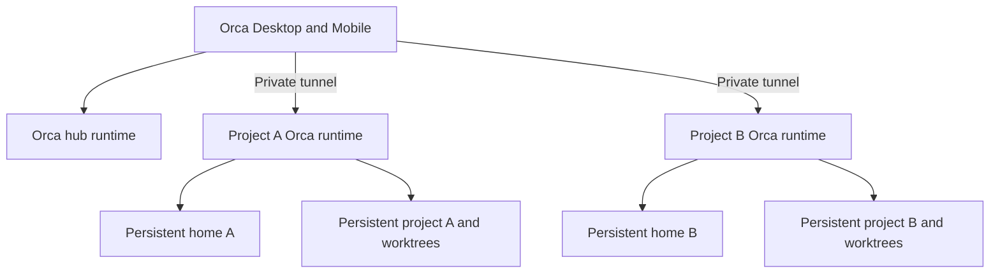

# Orca with persistent Coder project environments

## Status and prerequisites

This is a pilot, not a migration of existing Mux workspaces. The `orca-worker`
template is published through the existing Coder template workflow after merge.
The Orca hub image has its own build workflow. The cluster overlay selects the
hub and gives it a private HTTPS route through the Tailscale operator.

Required: Coder with the existing Kubernetes provisioner in namespace `coder`,
Linux amd64, private connectivity, Docker for local checks, and a project
repository providing the `coder` account (UID/GID 1000, home `/home/coder`).
The devcontainer needs Bash, curl, tar, sha256sum, getent, cut, chown, and mountpoint.
GitHub external auth is optional and enables private HTTPS cloning.

## Architecture and storage



Each worker has two independent PVCs. Neither depends on `start_count`; only the
Deployment and installer scripts follow the running state. The home is mounted
directly in the agent environment and excluded from Envbuilder's image build.
The setup checks the account and mountpoints before starting the Coder agent,
and repairs checkout ownership left by an interrupted first build.
Project checkout is always `/workspaces/project`. Envbuilder does not apply the
project's host bind mounts; copying a host `.gitconfig` is therefore optional.
Authenticate tools inside the workspace instead of relying on host credentials.

The design incorporates the Mux fixes already in this repository: commit
`3430eb1` removed the PVC's start/stop count after whole-home data loss; `4a4fde1`
aligned paths with the actual user; the August Docker-cache changes addressed
separate storage corruption. No existing Mux PVC or cache is changed here.

Envbuilder 1.3.0 is in maintenance mode and requires a privileged worker Pod.
This pilot accepts that tradeoff to reuse the existing devcontainer build path
without nested Docker. Replacement pods reuse matching build layers from the
internal registry. Envbuilder still builds from the persistent checkout and runs
the project lifecycle hooks. The cache uses content hashes and Envbuilder's
default seven-day TTL. Build context files deliberately copied into an image can
be cached, so keep secrets out of that context. Set `cache_repo` to an empty string
to disable caching.

Envbuilder accesses the HTTP registry from the pod using its full `.cluster.local`
service name. The registry client recognizes the `.local` suffix as local, so Git
and external HTTPS registries keep certificate verification. It does not require
the node runtime to resolve the service name.

Envbuilder installs Features alphabetically rather than honoring
`installsAfter`; the project therefore uses an official Node base image so npm is
available before the Renovate Feature runs. The base account is aligned to
`coder:1000:1000` without writing into the mounted home during the image build.
A Nix environment can later replace project tooling;
it does not replace persistent home storage, and its shell must be activated for
non-interactive agent launches as well as terminals.

## Local hub and worker setup

1. Build and start a local server-only hub:

   ```bash
   docker build -t elysium/orca-hub:2.0.0 images/orca-hub/context
   docker run -d --name orca-hub-pilot \
     --mount type=volume,src=orca-hub-pilot-home,dst=/home/coder \
     -e ORCA_PAIRING_ADDRESS=ws://127.0.0.1:16768 \
     -p 127.0.0.1:16768:6768 elysium/orca-hub:2.0.0
   docker exec -it orca-hub-pilot orca-ide pair --address ws://127.0.0.1:16768
   ```

   For a remote client, use a private forwarding address reachable from that
   client. Add `--mobile` to the pairing command for the phone.

2. Create one `orca-worker` workspace per project. Select the repository and
   devcontainer directory. Authenticate Codex and OpenCode inside each worker.
   Their installers preserve user configuration and login in `/home/coder`.

3. Forward the worker's TCP port 6768 through a private tunnel. In the Coder
   terminal, run `orca-ide pair --address ws://<tunnel-host>:<port>`. Add
   `--mobile` for the phone. Enter the link in the relevant Orca client.

## Validation and acceptance

Run local checks:

```bash
terraform -chdir=coder/templates/orca-worker init -backend=false
terraform -chdir=coder/templates/orca-worker validate
terraform -chdir=coder/templates/orca-worker test
ORCA_CACHE_TEST=true bash coder/templates/orca-worker/tests/storage-smoke.sh
```

The Terraform tests run in PR validation. A plan with the real Coder provider checks
template import before a workspace supplies the required repository. Workspace
metadata and infrastructure are overridden, so this needs no cluster access.
Mocked lifecycle tests check that a Coder stop removes compute while retaining both
PVC identities, then resumes on the same storage. The Docker integration check uses
synthetic authentication/configuration/history files, removes the whole worker
container, rebuilds its devcontainer on the same volumes, and verifies those files
and an uncommitted project file. It creates only disposable named volumes and
containers and removes them on exit. Cache mode starts a disposable HTTP registry,
verifies the second build hits the cache and inspects the cached layers for
synthetic credentials and persistent files (requires Python 3 and zstd).

On a dedicated Coder workspace, verify that Docker builds the devcontainer,
the startup script imports the checkout, and Desktop and Mobile can pair through
a private tunnel. Create worktrees in the worker and start agents in parallel.
After a stop/start or template update, compare PVC identities and confirm
pairings, settings, agent login and uncommitted project edits are still present.
Use the worker directly for project sessions. The hub is an independent runtime.

## Cluster promotion and rollback

The [hub base](../../apps/base/orca-hub) pins the published Linux amd64 image
by digest. The [AI overlay](../../apps/kyrion/ai) selects it and advertises its
Tailscale HTTPS hostname over WSS. The hostname uses the existing Flux
substitution for the tailnet domain. The hub has a single replica and replaces
the old pod before mounting its home in the new pod. Flux preserves the PVC if
the app is removed from the overlay.

Publish and test the server-only image before changing the deployment digest.
Before activating it, preserve the existing Orca profile in a private backup
outside the hub PVC and verify that it can be read back. Preserve the previous
digest for rollback.

After Flux reconciles the activation commit:

1. Confirm the hub pod is Ready on TCP port 6768, its PVC is Bound, and the
   Tailscale ingress still routes WSS. The server-only root URL returns HTTP 404.
2. Confirm startup logs contain no offers. To issue one interactively, run
   `kubectl -n ai exec -it deployment/orca-hub -- orca-ide pair --address <hub-wss-url>`.
   Add `--mobile` for the phone and give the link only to the intended client.
3. Verify a client can connect, that an existing grant still works after
   replacement and that the hub uses the same PVC.

The hub home contains the Orca profile, grants and Coder client state. This
pilot has no scheduled backup for that volume. A storage loss means rebuilding
the profile and pairing again. Coder project files and agent homes are on the
worker PVCs. Keep provider credentials inside the workers.

Stop dedicated Coder workers to pause the experiment; deleting a workspace can
delete its Terraform-managed PVCs. Export or back up data before deletion.
Stop the local hub with `docker stop orca-hub-pilot` and preserve its named home
volume. For an enabled cluster installation, revert the selection through a PR
and follow [destructive-change](destructive-gitops-change.md) and
[backup/restore](backup-and-restore.md) procedures before any retained-volume
removal. Existing Mux workspaces remain available throughout.

## References

- [Worker template](../../coder/templates/orca-worker/README.md)
- [Hub image](../../images/orca-hub/README.md)
- [Orca run modes](https://www.onorca.dev/docs/ways-to-run)
- [Orca SSH](https://www.onorca.dev/docs/ssh)
- [Envbuilder maintenance notice](https://github.com/coder/envbuilder)
