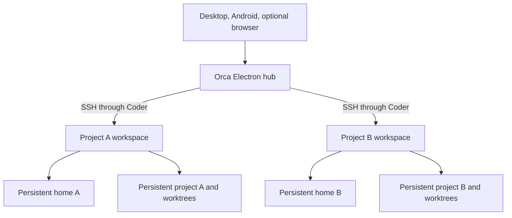

# Orca with persistent Coder project environments

## Status and prerequisites

This is a pilot, not a migration of existing Mux workspaces. The `orca-worker`
template is published through the existing Coder template workflow after merge.
The Orca hub image has its own build workflow. The cluster overlay selects the
hub and gives it a private HTTPS route through the Tailscale operator.

Required: Coder with the existing Kubernetes provisioner in namespace `coder`,
Linux amd64, private connectivity, Docker for local checks, and a project
repository providing the `coder` account (UID/GID 1000, home `/home/coder`).
The devcontainer needs Bash, curl, tar, sha256sum, getent, cut, chown, and mountpoint.
GitHub external auth is optional and enables private HTTPS cloning.

## Architecture and storage



Each worker has two independent PVCs. Neither depends on `start_count`; only the
Deployment and installer scripts follow the running state. The home is mounted
directly in the agent environment and excluded from Envbuilder's image build.
The setup checks the account and mountpoints before starting the Coder agent,
and repairs checkout ownership left by an interrupted first build.
Project checkout is always `/workspaces/project`. Envbuilder does not apply the
project's host bind mounts; copying a host `.gitconfig` is therefore optional.
Authenticate tools inside the workspace instead of relying on host credentials.

The design incorporates the Mux fixes already in this repository: commit
`3430eb1` removed the PVC's start/stop count after whole-home data loss; `4a4fde1`
aligned paths with the actual user; the August Docker-cache changes addressed
separate storage corruption. No existing Mux PVC or cache is changed here.

Envbuilder 1.3.0 is in maintenance mode and requires a privileged worker Pod.
This pilot accepts that tradeoff to reuse the existing devcontainer build path
without nested Docker. Replacement pods reuse matching build layers from the
internal registry. Envbuilder still builds from the persistent checkout and runs
the project lifecycle hooks. The cache uses content hashes and Envbuilder's
default seven-day TTL. Build context files deliberately copied into an image can
be cached, so keep secrets out of that context. Set `cache_repo` to an empty string
to disable caching.

Envbuilder accesses the HTTP registry from the pod using its full `.cluster.local`
service name. The registry client recognizes the `.local` suffix as local, so Git
and external HTTPS registries keep certificate verification. It does not require
the node runtime to resolve the service name.

Envbuilder installs Features alphabetically rather than honoring
`installsAfter`; the project therefore uses an official Node base image so npm is
available before the Renovate Feature runs. The base account is aligned to
`coder:1000:1000` without writing into the mounted home during the image build.
A Nix environment can later replace project tooling;
it does not replace persistent home storage, and its shell must be activated for
non-interactive agent launches as well as terminals.

## Local hub and worker setup

1. Build the hub from the repository root:

   ```bash
   docker build -t elysium/orca-hub:1.0.0 images/orca-hub/context
   docker run -d --name orca-hub-pilot \
     --mount type=volume,src=orca-hub-pilot-home,dst=/home/coder \
     -e ORCA_PAIRING_ADDRESS=ws://127.0.0.1:16768 \
     -p 127.0.0.1:16768:6768 elysium/orca-hub:1.0.0
   ```

   Loopback is suitable for an SSH-forwarded browser check, not a phone or remote
   native client. For native clients, bind only an approved private interface and
   advertise its reachable address. Do not expose the runtime port publicly.
   The browser bundle is served at the forwarded port. Pairing is still required.

2. Create an `orca-worker` workspace in Coder. Select the project repository and
   devcontainer directory. Wait for the Codex and OpenCode installers to finish.
   Use one workspace per project. A normal Coder stop retains its two PVCs.

3. Authenticate the hub's Coder CLI interactively:

   ```bash
   docker exec -it orca-hub-pilot coder login https://coder.example.com
   docker exec -it orca-hub-pilot coder config-ssh
   ```

   Substitute the deployment URL locally. The hub home retains CLI configuration
   and SSH config. Never place its session token in Git or a command argument.
   Import the generated OpenSSH workspace alias in Orca's SSH settings. Verify
   that the generated Coder `ProxyCommand` works before launching an agent.

4. In the worker, authenticate Codex with its supported browser/device login and
   connect OpenCode to OpenRouter. Keep their files under `/home/coder`.
   The Codex module has `manage_config = false` and supplies no API key, so it
   preserves user configuration and login. OpenCode installation changes only its
   executable. No AI agent needs to run on the hub for a project task.

5. On desktop, add/pair the hub and select the workspace as an SSH target. Create
   task worktrees below the persistent project path. For Android, recreate the hub on the same home volume with
   `ORCA_MOBILE_PAIRING=1` to request a mobile-scoped link. Previously paired
   desktop clients retain their grants. Direct SSH and paired Orca runtimes differ in structured
   chat features: validate the actual chat, approval, and history flow on both
   clients rather than assuming identical behavior.

## Validation and acceptance

Run local checks:

```bash
terraform -chdir=coder/templates/orca-worker init -backend=false
terraform -chdir=coder/templates/orca-worker validate
terraform -chdir=coder/templates/orca-worker test
ORCA_CACHE_TEST=true bash coder/templates/orca-worker/tests/storage-smoke.sh
```

The Terraform tests run in PR validation. A plan with the real Coder provider checks
template import before a workspace supplies the required repository. Workspace
metadata and infrastructure are overridden, so this needs no cluster access.
Mocked lifecycle tests check that a Coder stop removes compute while retaining both
PVC identities, then resumes on the same storage. The Docker integration check uses
synthetic authentication/configuration/history files, removes the whole worker
container, rebuilds its devcontainer on the same volumes, and verifies those files
and an uncommitted project file. It creates only disposable named volumes and
containers and removes them on exit. Cache mode starts a disposable HTTP registry,
verifies the second build hits the cache and inspects the cached layers for
synthetic credentials and persistent files (requires Python 3 and zstd).

Verify all of these with the local hub on dedicated Coder workspaces, then repeat
the relevant checks against the deployed hub during cluster activation:

- Clone, tool installation and Git worktree creation complete successfully.
- Home files, settings, login and project edits survive stop/start, Pod replacement
  and template/image update. Compare PVC identities before and after each step.
- Codex and OpenCode run concurrently on different worktrees; project A cannot
  access project B's mounted files. Shared cluster permissions/network access are
  separate from filesystem isolation.
- Desktop and Android can read chat, answer approvals and inspect diffs through
  the hub. Disconnecting desktop leaves worker processes running.
- Hub replacement retains SSH targets and pairing identity, then reconnects to
  running workers without duplicating agent sessions.

If hub-to-worker SSH or the required chat flow fails, retain the evidence and stop
promotion. A per-workspace Orca runtime is a separate architecture decision.

## Cluster promotion and rollback

The [hub base](../../apps/base/orca-hub) pins the published Linux amd64 image
by digest. The [AI overlay](../../apps/kyrion/ai) selects it and advertises its
Tailscale HTTPS hostname over WSS. The hostname uses the existing Flux
substitution for the tailnet domain. The hub has a single replica and replaces
the old pod before mounting its home in the new pod. Flux preserves the PVC if
the app is removed from the overlay.

After Flux reconciles the activation commit:

1. Confirm the hub pod is Ready, its PVC is Bound and the Tailscale ingress has
   an HTTPS address. Load the web bundle from a client on the tailnet.
2. The hub starts with pairing offers disabled. Keep this flag in the deployed
   manifest so Kubernetes log readers cannot obtain an access link. The pinned
   hub release lacks the on-demand `pair` command. Before onboarding new
   clients, upgrade to a release that supports it and verify that an authorized
   operator can issue an invite over `kubectl exec`. Keep the output private.
   Review previously issued invites and device grants and revoke any
   unrecognized grants. Changing startup arguments cannot remove old logs.
3. Authenticate Coder on the hub with a dedicated credential. Configure its
   OpenSSH alias on the hub and test that it reaches the worker checkout.
   On the paired desktop, select the hub when adding the SSH target so the
   connection is owned by the hub. Add `/workspaces/project` from that target
   and verify the worktree and terminal run on the worker.
4. Exercise chat, approvals and persistence across a hub replacement before
   relying on it for agent work.

The hub home contains the Orca profile, grants and Coder client state. This
pilot has no scheduled backup for that volume. A storage loss means rebuilding
the profile and pairing again. Coder project files and agent homes are on the
worker PVCs. Keep provider credentials inside the workers.

Stop dedicated Coder workers to pause the experiment; deleting a workspace can
delete its Terraform-managed PVCs. Export or back up data before deletion.
Stop the local hub with `docker stop orca-hub-pilot` and preserve its named home
volume. For an enabled cluster installation, revert the selection through a PR
and follow [destructive-change](destructive-gitops-change.md) and
[backup/restore](backup-and-restore.md) procedures before any retained-volume
removal. Existing Mux workspaces remain available throughout.

## References

- [Worker template](../../coder/templates/orca-worker/README.md)
- [Hub image](../../images/orca-hub/README.md)
- [Orca run modes](https://www.onorca.dev/docs/ways-to-run)
- [Orca SSH](https://www.onorca.dev/docs/ssh)
- [Envbuilder maintenance notice](https://github.com/coder/envbuilder)
